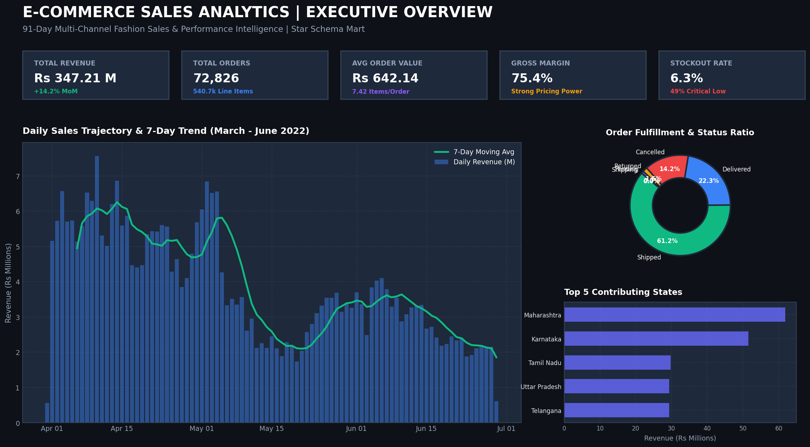
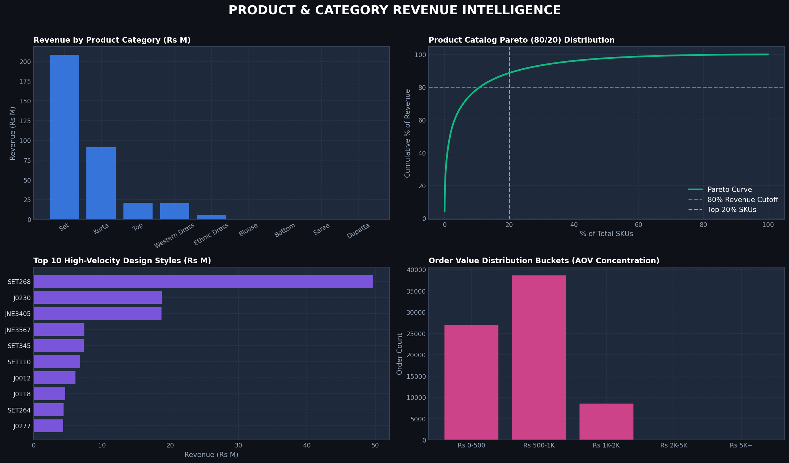
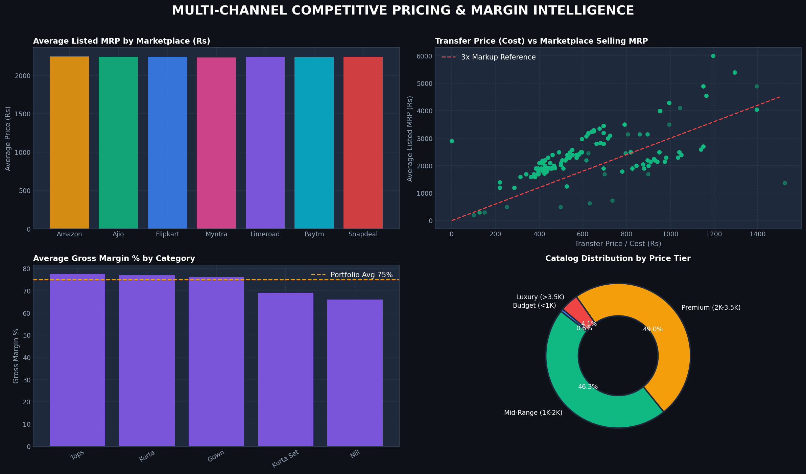
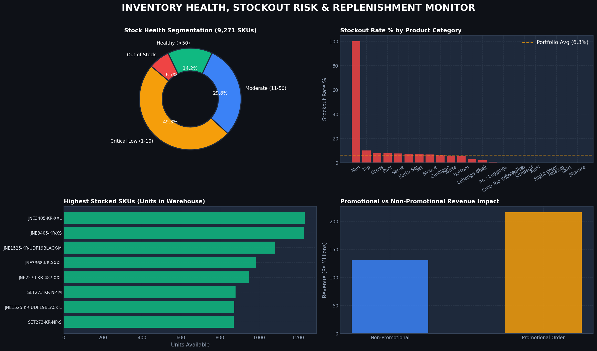
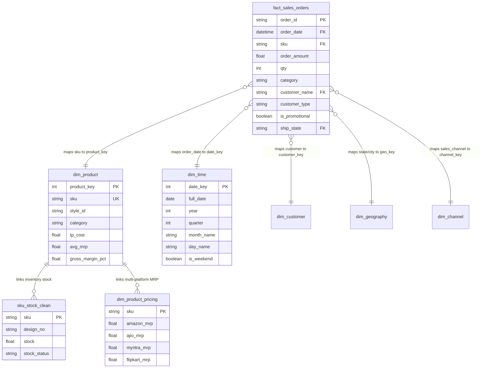
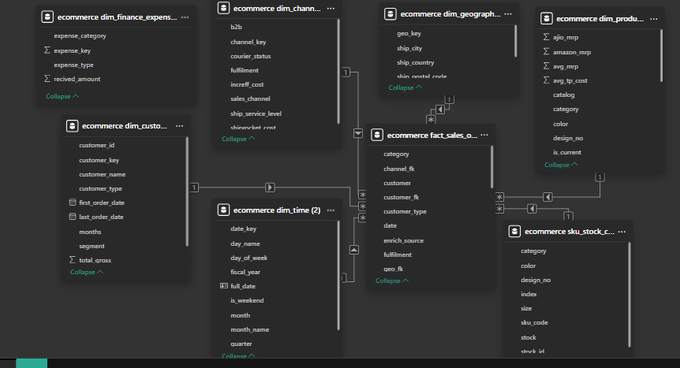

# E-Commerce Sales Analytics & Business Intelligence Platform
### ₹347.2M GMV Deep Dive | 91-Day Indian Multi-Channel Fashion Dataset

[](https://python.org)
[](https://streamlit.io)
[](https://plotly.com)
[](https://mysql.com)
[](ecommerce.pbix)
[](#-data-modeling--star-schema-architecture)

**End-to-End Data Modeling, ETL Pipeline & Interactive Business Intelligence Dashboard**  
*540,716 transaction lines • 72,826 orders • 1,330 SKUs • Multi-channel pricing intelligence across Amazon, Ajio, Myntra, Flipkart, Limeroad, Paytm, and Snapdeal.*

---

##  Interactive Dashboard Previews

### 1. Executive C-Suite KPI Overview


### 2. Product Catalog & Category Intelligence


### 3. Multi-Channel Competitive Pricing & Margin Intelligence


### 4. Inventory Health & Stockout Risk Monitor


---

## Quick Start: Launch the Interactive Dashboard

You can run the full interactive BI dashboard locally with a single command:

```bash
# 1. Clone the repository
git clone https://github.com/AKSUF/ecommerce.git
cd ecommerce

# 2. Install dependencies
pip install -r requirements.txt

# 3. (Optional) Run automated ETL pipeline to rebuild database from raw CSVs
python etl_pipeline.py

# 4. Launch the Streamlit Interactive Dashboard
streamlit run app.py
```
*The dashboard will automatically open in your browser at `http://localhost:8501`.*

---

## Project Overview & Business Problem

In multi-channel retail fashion, brands often suffer from operational blind spots: **customer concentration risk**, **costly stockouts in high-demand categories**, and **inconsistent pricing across marketplaces**.

This project converts 8 fragmented operational CSV datasets into a **normalized 3NF Star Schema data warehouse** and an **interactive business intelligence platform** to deliver data-backed recommendations yielding a projected **10–15% revenue uplift**.

### Key Business Metrics & Findings
| Focus Area | Quantitative Finding | Strategic Recommendation |
| :--- | :--- | :--- |
| **Gross Revenue** | **₹347.2M GMV** with an average gross margin of **75.4%** | Brand exhibits strong pricing power; avoid margin-diluting discount wars. |
| **Basket Metrics** | **AOV ₹642.14** with an average basket size of **7.42 items/order** | High repeat basket volume; implement ₹999 threshold for free shipping perks. |
| **Customer Risk** | **Top 10 customers contribute 51.65% of revenue** (Pareto rule) | High vulnerability to single-buyer churn; scale D2C acquisition to diversify. |
| **Product Mix** | **Kurtas (61.6% SKUs)** and **Sets (27.0% SKUs)** drive 88%+ volume | Reallocate working capital toward high-margin Tops (79.8% margin) and Sets. |
| **Multi-Platform Pricing** | Benchmark across 7 platforms shows stable listed MRP (~₹2,240) | Multi-channel consistency protects brand equity against marketplace arbitrage. |
| **Stockout Risk** | **6.3% of SKUs completely out of stock**; 49% in critical low tier (1–10 units) | Prioritize automated replenishment for top 50 revenue-generating SKUs. |
| **Promotions** | 59% of orders promotional; **Free Shipping generates 61% of promo revenue** | Double down on free shipping thresholds instead of flat percentage discounts. |

---

##  Data Modeling & Star Schema Architecture

The data pipeline extracts 8 messy operational tables and loads them into a clean **Star Schema** with surrogate keys, temporal dimensions, and indexed foreign key relationships.



<p align="center">
  
</p>

---

##  Advanced SQL Analytical Queries

The SQL warehouse in `query/` contains enterprise-level queries utilizing CTEs, window functions, and statistical aggregations:

- **Pareto Customer Concentration Analysis:** Evaluates cumulative revenue percentages using `SUM() OVER (ORDER BY revenue DESC ROWS UNBOUNDED PRECEDING)` to segment accounts into Top 50%, Pareto 80%, and Long Tail.
- **Cross-Marketplace Price Variance:** Compares Amazon MRP against Ajio, Flipkart, and Myntra using unpivoted CTEs to detect pricing anomalies and marketplace arbitrage.
- **Stockout & Stock Concentration Analysis:** Segments inventory into quartiles and calculates categorical stockout rates using conditional aggregation (`SUM(CASE WHEN stock <= 0 THEN 1 ELSE 0 END)`).
- **Time-Series Moving Averages & Day-of-Week Seasonality:** Identifies peak purchasing days (Wednesday & Sunday) to optimize promotional scheduling.

---

##  Repository Structure

```text
├── app.py                      # Main Streamlit Interactive BI Dashboard
├── etl_pipeline.py             # Automated Python ETL pipeline (CSVs -> Star Schema)
├── requirements.txt            # Python dependencies
├── RESUME_GUIDE.md             # B.Tech Resume bullet points & technical interview prep
├── ecommerce.pbix              # Original Power BI Dashboard model
├── ecommerce.docx              # Comprehensive 35-page project research report
├── data/                       # Normalized Star Schema database & Parquet store
│   ├── ecommerce.db            # High-performance SQLite Star Schema database
│   ├── fact_sales_orders.parquet
│   ├── dim_product_pricing.parquet
│   ├── raw_orders.parquet
│   └── sku_stock_clean.parquet
├── query/                      # Production SQL scripts & analytical queries
│   ├── ecoidentifieranalysis.sql  # 990 lines of analytical SQL queries
│   ├── ecomodification.sql         # DDL, ETL transformation & Star Schema creation
│   ├── ecoprocedure.sql            # Automated column profiling stored procedures
│   ├── ecoviewtable.sql            # Reusable analytical BI views
│   └── modelerd.mwb                # MySQL Workbench physical data model
├── archive/                    # Raw operational CSV datasets (Amazon, Intl, May Pricing, etc.)
├── scripts/
│   └── generate_screenshots.py # Dashboard infographic screenshot generator
└── image/                      # High-resolution dashboard screenshots & ERD diagrams
```

---

##  Resume & Portfolio Highlights

This project demonstrates core competencies sought by hiring managers for **Data Analyst**, **Business Intelligence Engineer**, and **Data Engineer** roles:

- **End-to-End Ownership:** From raw, messy CSVs to a normalized Star Schema data warehouse, analytical SQL queries, and interactive web dashboard.
- **Quantifiable Business Value:** Translates complex datasets into executive KPIs (AOV, gross margin, stockout rates, Pareto distribution) and actionable growth strategies.
- **Production-Ready Tech Stack:** Python (Streamlit, Plotly, Pandas), SQL (CTEs, Window Functions, Surrogate Keys), and columnar Parquet optimization.

>  **Applying for jobs?** Check out [`RESUME_GUIDE.md`](RESUME_GUIDE.md) for ready-to-copy resume bullet points, interview Q&A scripts, and free 1-click cloud deployment instructions.
